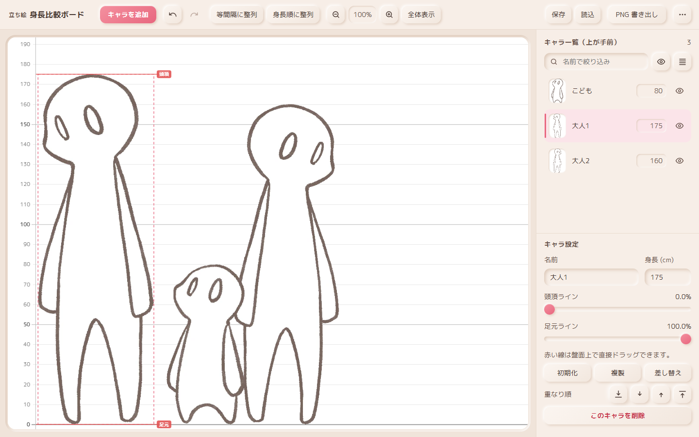

# 立ち絵身長比較ボード

立ち絵を身長どおりの縮尺で横に並べて、キャラクター同士の背の高さを見比べるツール。

**▶ [https://woolwag3338.github.io/character-height-board/](https://woolwag3338.github.io/character-height-board/)**



インストールは要りません。上のリンクを開いて、立ち絵をドラッグ＆ドロップするだけです。
**画像はブラウザの中だけで処理され、どこにもアップロードされません。**

作成者：[Wool&Wag](https://x.com/WW_3338)

---

## できること

- 画像をドラッグ＆ドロップし、名前と身長(cm)を入れるだけで縮尺が揃う
- 透過部分を除いた外接矩形を自動で検出し、指定した身長に合わせて拡大縮小する
- 頭頂・足元のラインは手で調整できる（獣耳、帽子、浮いている足元などに対応）
- 横方向は自由配置。**等間隔に整列**／**身長順に整列**のボタンもある
- 重なり順の変更、複製（身長違いの比較用）、表示・非表示の切り替え
- 盤面を **PNG で書き出し**。元画像の解像度を活かした高解像度で出力する
- **`.hboard` ファイル**で保存・読込。画像も含めて 1 ファイルにまとまる
- **自動保存**。次に開いたとき前回の盤面が復元される

## 使い方

1. 上のリンクを開く
2. 立ち絵の画像をウィンドウにドラッグ＆ドロップする
   - 複数枚をまとめて落とすと、一覧形式の入力ダイアログが出る
   - 名前の初期値には拡張子を除いたファイル名が入る
3. 身長(cm)を入力すると、その高さになるよう縮尺が揃えられる
4. ずれていたら、キャラを選択して**頭頂ライン／足元ライン**を調整する
5. 並べ終えたら **PNG 書き出し**、または `.hboard` で保存する

> 帽子や獣耳を身長に含めたくない場合は、頭頂ラインを頭のてっぺんまで下げてください。
> 「地面から頭頂ラインまで」が入力した身長になります。

### 画像の形式について

**背景が透過された PNG または WebP を推奨します。**
透明な部分を除いた範囲を自動で検出し、そこが指定した身長になるよう縮尺を合わせるためです。

**画像の周囲に透明な余白が残っていても、そのまま読み込んで構いません。**
余白は自動で除かれるので、あらかじめ切り詰めておく必要はありません。

次の場合だけ、**頭頂ライン・足元ラインを手で合わせる必要があります**。

- **透過されていない画像**（JPEG など）
  余白ぶんも身長に含まれてしまうため
- **発光・ぼかし影・薄いオーラなど、半透明の効果がある立ち絵**
  うっすら色が乗っている部分も「絵の一部」として拾うため、
  頭頂ラインが光の上端に付き、キャラがその分だけ小さく描かれる

## 操作一覧

| 操作 | 動作 |
| --- | --- |
| ホイール | 拡大縮小（カーソル位置が基準） |
| Shift＋ホイール | 横スクロール |
| 空白をドラッグ | 表示位置を移動 |
| 中ボタンでドラッグ | 表示位置を移動（キャラの上からでも可） |
| キャラをドラッグ | 左右に移動（縦は床に固定） |
| 矢印キー | 選択中のキャラを微調整（Shift 併用で 10 倍） |
| 空白をクリック／Esc | 選択解除 |
| 倍率表示をクリック | 等倍（100%）に戻す |
| `Ctrl+Z` | 元に戻す |
| `Ctrl+Shift+Z` / `Ctrl+Y` | やり直す |

## 動作環境

- Chrome / Edge / Firefox / Safari の新しめのバージョン
- インストール・アカウント登録・通信はいずれも不要
- 自動保存に IndexedDB を使う。プライベートウィンドウなどで使えない環境では、
  **自動保存だけが無効**になり、そのことを画面上で知らせる（他の機能は動く）
- 丸ゴシック体（M PLUS Rounded 1c）を Google Fonts から読み込む。
  読めない環境では端末の書体に落ちるだけで、機能は変わらない

### オフラインで使う

このページの `index.html` を保存すれば、ダブルクリックで開いて使えます。
ただし `file://` で開いた場合、ブラウザによっては IndexedDB が使えず自動保存が無効になります。
自動保存も使いたい場合は、ローカル HTTP サーバー経由で開いてください。

```bash
python -m http.server 8765 --bind 127.0.0.1
```

## プライバシーについて

- 読み込んだ画像は**すべてブラウザ内で処理**され、どこにもアップロードされません
- 保存先も手元のブラウザ（IndexedDB）と、書き出したファイルだけです
- ただしアクセス解析のため [Google Analytics](https://policies.google.com/technologies/partner-sites)
  を利用しており、ページの閲覧状況（アクセス日時・参照元・ブラウザの種類など）が Google に送信されます。
  **画像やファイル名が送信されることはありません**

同じ内容はツール内の「その他」メニュー →「このツールについて」からも読めます。

## ライセンス

コードは MIT ライセンスです（→ [LICENSE](LICENSE)）。

**読み込んだ立ち絵や、書き出した画像は本ライセンスの対象外です。**
それらの権利は各権利者に帰属します。
